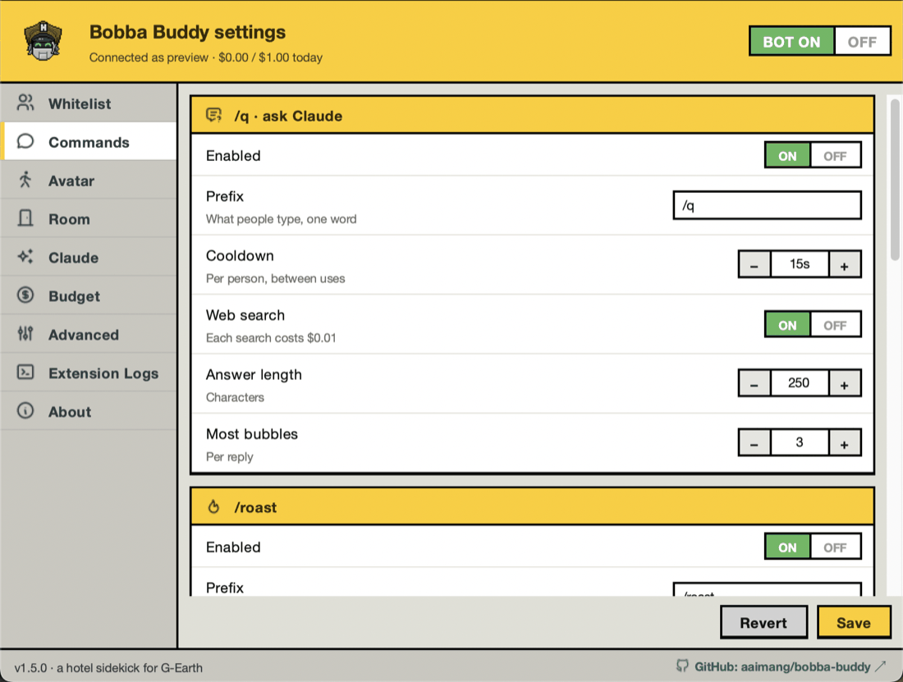
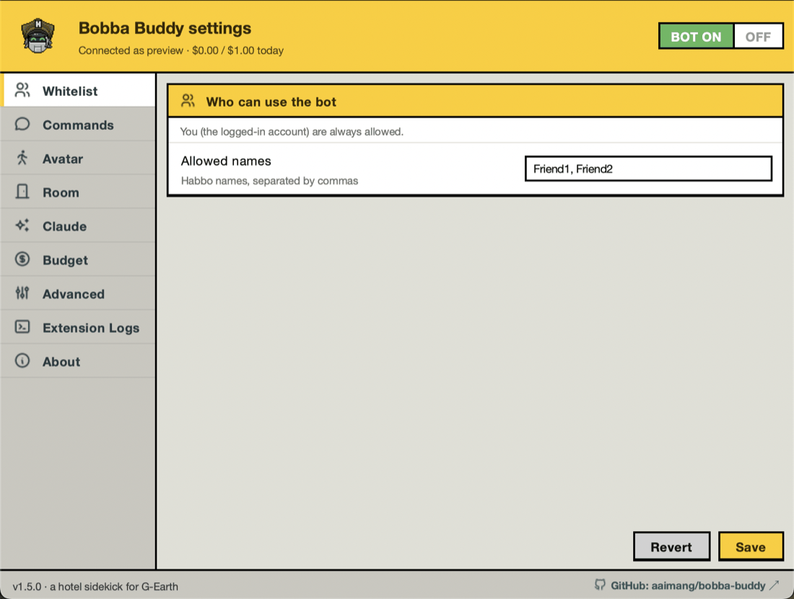
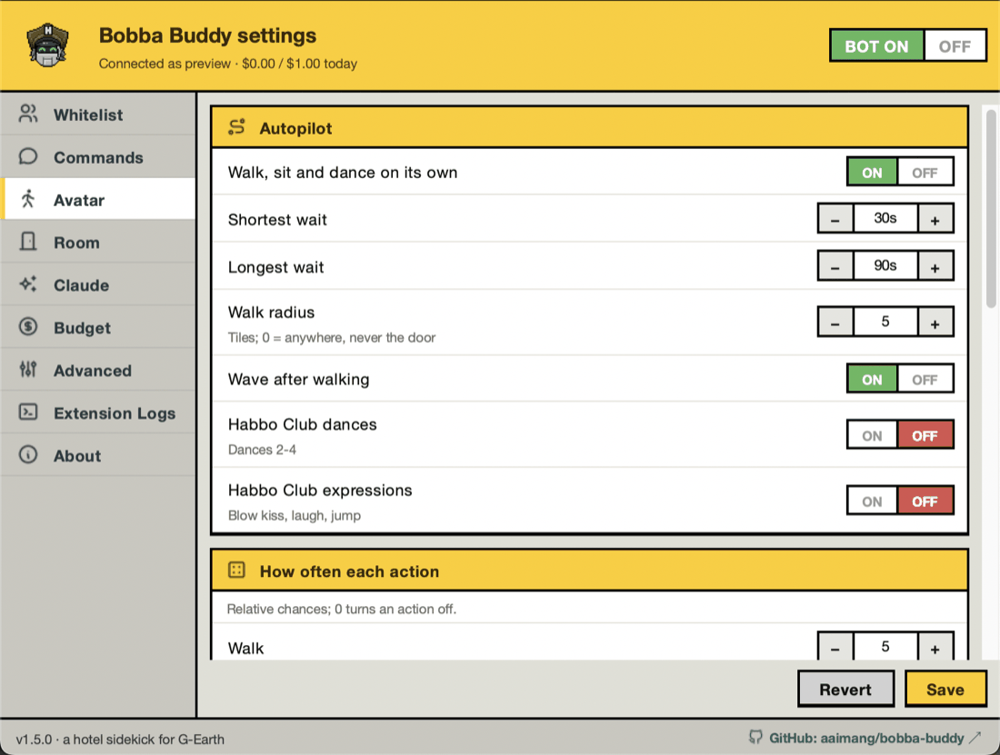
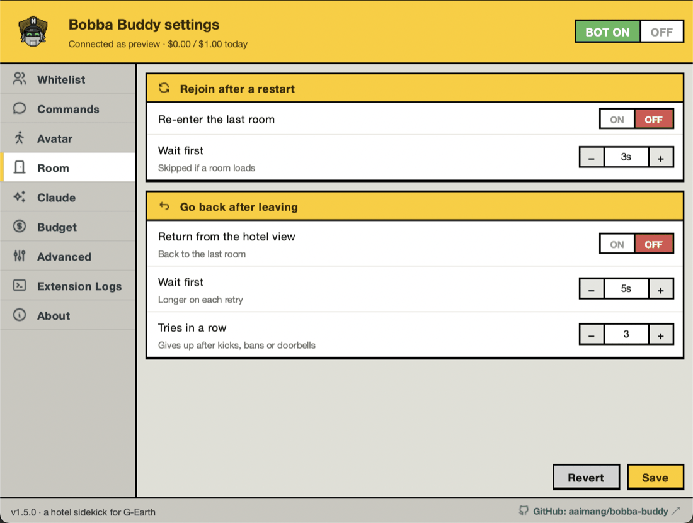
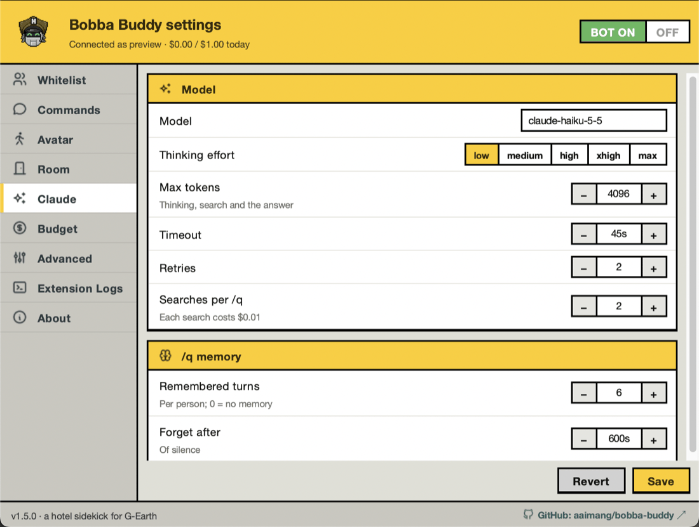
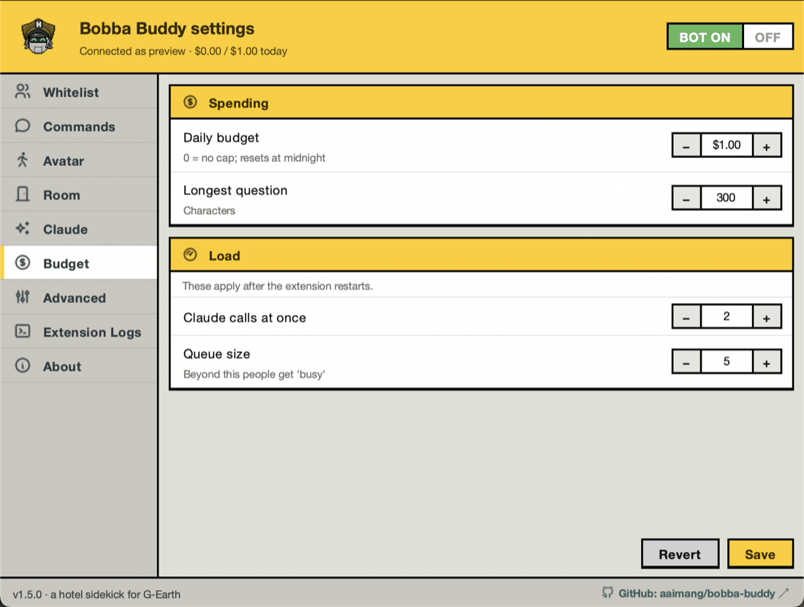
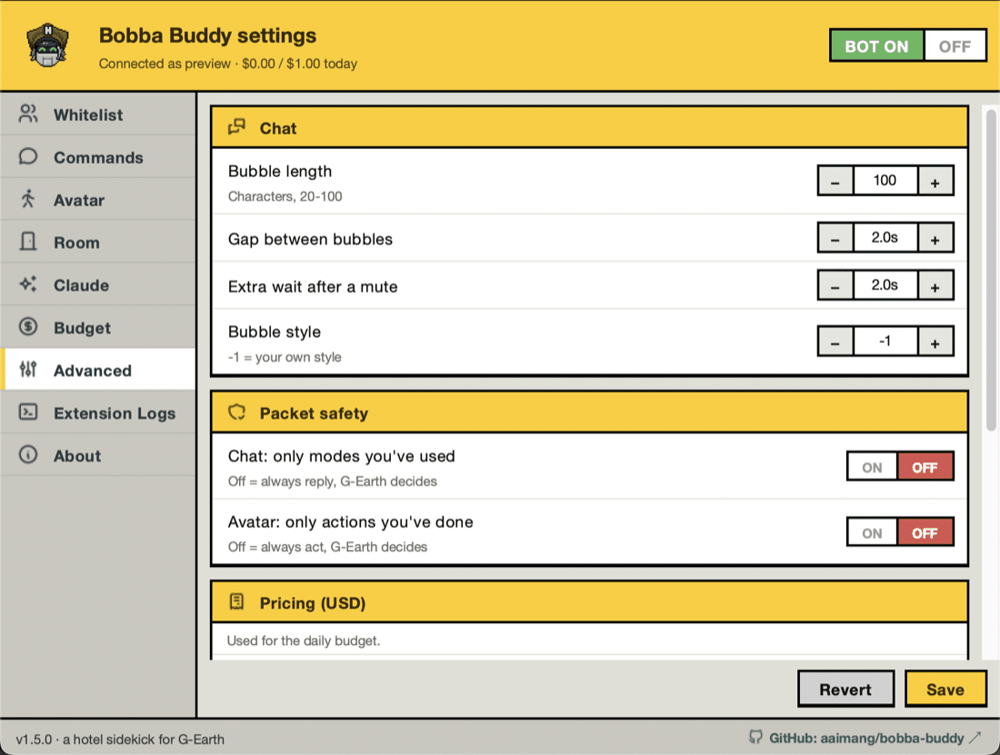
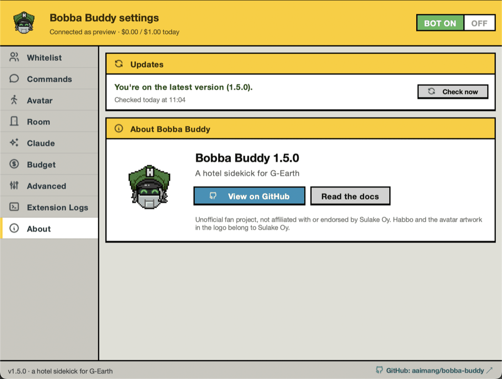
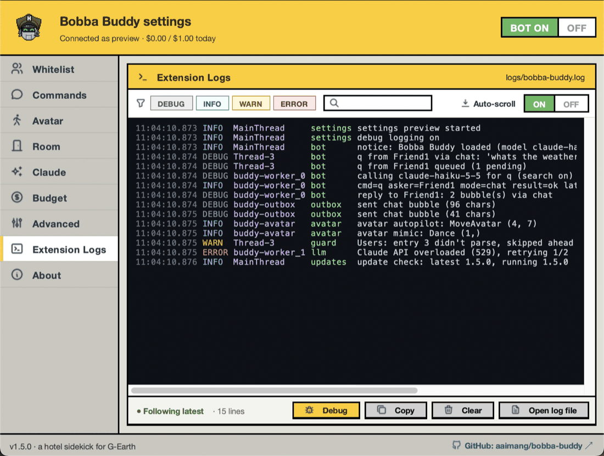
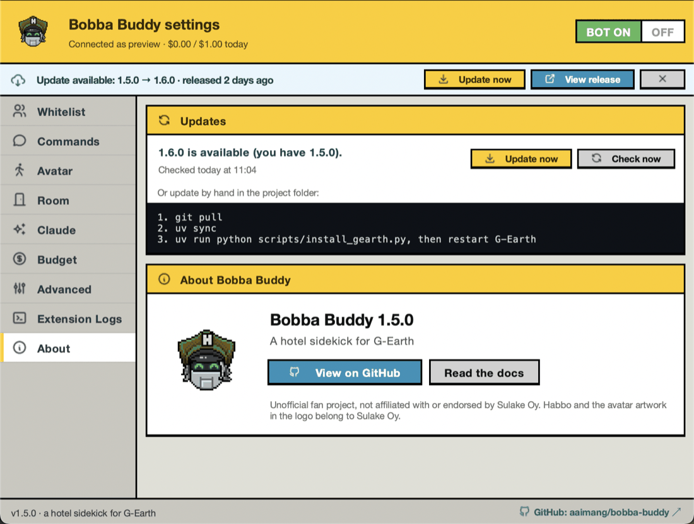

# Settings window

[← Contents](MAIN_CONTENT.md)

Since 1.3.0, every option in `config.toml` can be changed from a Habbo-style window instead of editing the file, and since 1.4.0 it also shows the bot's log live. It works on macOS, Windows and Linux.

## Opening it

- **From G-Earth:** press **▶** next to Bobba Buddy in the Extensions tab. Pressing ▶ again while the window is open brings it to the front instead of opening a second one.
- **Without G-Earth** (to look around or edit `config.toml`): run `uv run python -m bobba_buddy.settings`. Add `--page Avatar` to open on a page, or `--page "Extension Logs" --demo-logs` to see the log page with sample lines. The ON/OFF switch and status line are simulated in this mode, but Save writes the real file.

Closing the window doesn't stop the bot. It keeps running in G-Earth.

## The header

- **BOT ON / OFF** pauses everything: chat commands, copying, autopilot and anti-idle. It used to be G-Earth's ▶ button (before 1.3.0). Switching ON also clears a "bot paused" API error once you've fixed the key or model.
- **Status line:** who you're connected as (or "Waiting for the hotel"), and today's spend against the daily budget. If the bot paused itself after an API error, the reason shows here in red.

## The pages

| Page | What's on it |
|---|---|
| **Whitelist** | The Habbo names allowed to use the commands, separated by commas. You are always allowed. |
| **Commands** | One box per command (`/q`, `/roast`, `/suggest`, `/joke`): on/off, prefix, cooldown, answer length, most bubbles, and web search where it applies. `/roast` adds the same-target cooldown and the "never roast" names. |
| **Avatar** | Autopilot (waits, walk radius, waving, Habbo Club dances and expressions), how often each action is picked, copying nearby players, anti-idle and its wake-up actions, and timing. |
| **Room** | Rejoining the last room after a restart, and going back after landing on the hotel view. |
| **Claude** | Model, thinking effort, max tokens, timeout, retries, searches per `/q`, and `/q` memory. |
| **Budget** | Daily budget and question length; the number of Claude calls at once and the queue size (these two apply after the extension restarts). |
| **Advanced** | Chat timing and bubble style, packet safety (`require_seen_packets`), the prices used for the budget, the room reload packet, and update checks. |
| **Extension Logs** | The bot's log, live, in a terminal view (since 1.4.0). See [Extension Logs](#extension-logs) below. |
| **About** | The **Updates** box (status, Check now, Update now) and the logo, version, GitHub and docs links, and the fan-project disclaimer. |

Save and Revert only appear on the pages with settings; About and Extension Logs don't have them.

## Controls

| Control | How it works |
|---|---|
| **ON / OFF** | Click either half. |
| **− / +** | Click, or hold to keep counting. You can also type a number and press Return, or use the ↑ and ↓ keys. Values stay within the allowed range. |
| **Text box** | Prefixes, the model and the reload packet. |
| **Names** | Comma-separated, e.g. `Friend1, Friend2`. Capitals are kept in the file; matching ignores them. |
| **Choice** | Thinking effort: click one of `low` … `max`. |
| **Chips** | Wake-up actions: click to turn each one on or off. They're tried in the order shown. |

## Extension Logs

For debugging: what the bot is doing right now, line by line, as it happens. It shows the same lines the bot writes to `logs/bobba-buddy.log` in the project folder, kept in memory (the last 2,000), so lines from before you opened the window are there too.

Each line shows the time (to the millisecond), the level, the thread and the part of the bot that logged it, then the message. Levels are coloured: DEBUG grey, INFO blue, WARN amber, ERROR red.

| Control | What it does |
|---|---|
| **Auto-scroll** | ON (the default) keeps the newest line in view; the status shows "● Following latest". Scrolling up to read turns it OFF and the status shows "❚❚ Paused · N new" as lines keep arriving; scroll back to the bottom, or switch it ON, to follow again. |
| **DEBUG / INFO / WARN / ERROR** | Show or hide each level. |
| **Filter box** | Only show lines containing that text (any case), e.g. a name or `avatar`. |
| **Debug** | Turns on DEBUG logging in the running bot, for step-by-step detail: each command received and queued, the Claude call, the reply's bubbles, each bubble sent. It goes back to normal when the bot restarts, and `config.toml` doesn't change. The button is yellow while it's on. |
| **Copy** | Copies the lines shown, e.g. to paste into a bug report. |
| **Clear** | Empties the view. The log file isn't touched. |
| **Open log file** | Opens `logs/bobba-buddy.log` in your system's default app. |

The status line also counts the lines shown. On a narrow window it moves above the buttons, so nothing is cut off.

To try it without G-Earth, with sample lines: `uv run python -m bobba_buddy.settings --page "Extension Logs" --demo-logs`.

## Updates

Since 1.5.0 the bot asks GitHub once a day whether there's a newer release. When there is, a light-blue banner appears under the header on every page, and the G-Earth console says so once.

| Banner button | What it does |
|---|---|
| **Update now** | Asks first, then runs `git pull`, `uv sync` (only if the dependencies changed) and the G-Earth installer. The banner shows each step; every command's output also goes to Extension Logs. |
| **View release** | Opens the release notes on GitHub. |
| **✕** | Hides the banner until a newer version comes out. |

When the update is done, the banner turns green and asks you to **restart G-Earth**: the bot keeps running the old version until G-Earth starts it again. It can't restart itself, because G-Earth gives each extension a one-time login when it launches it.

**Update now** only runs when it's safe. The project must be a git checkout on `main` that tracks GitHub, with no edited files (your `config.toml`, `.env`, `logs/` and `state/` don't count; git ignores them), and the update mustn't be a new major version, which could change `config.toml`. Otherwise the banner turns red, says why, and **How to update** opens the About page with the steps to run by hand.

The **Updates** box on the About page shows the same status, when GitHub was last asked, a **Check now** button, and the manual steps when an update is available. To stop the daily check, turn off **Advanced → Update checks** (it sends your IP address to GitHub).

To see the banner without G-Earth: `uv run python -m bobba_buddy.settings --demo-update 9.9.0`.

## Saving

- **Changes wait for Save** (on the settings pages). The line next to the buttons counts unsaved changes. Changing a setting back to its saved value removes it from the count.
- **Save** (or ⌘S on a Mac, Ctrl+S elsewhere) checks everything first, with the same rules the bot uses when it loads `config.toml`. Then it writes the file and the bot applies it straight away, with no 2-second wait. "Claude calls at once" and "Queue size" still need an extension restart, and the window says so.
- **Your file stays yours.** Only the settings you changed are rewritten. Comments, order and everything else stay as they are. If `config.toml` doesn't exist yet, it's created from `config.example.toml`.
- **A bad value** (for example two commands with the same prefix, or a longest autopilot wait shorter than the shortest) isn't saved. The window jumps to that setting, turns its name red and explains the problem. The file isn't touched.
- **Revert** puts back the saved values.
- **Closing with unsaved changes** asks whether to save them first.
- **Editing the file by hand** still works. An open window reloads it when it changes, unless you have unsaved changes; then it warns you, and Save only writes the settings you changed.

## Good to know

- **On macOS** the window floats above other apps until you click into it, because a background process (the bot, started by G-Earth) isn't always allowed to take focus. While it's open it shows the Bobba Buddy logo in the Dock, and the menu bar and Dock say "Bobba Buddy" instead of "Python"; the icon goes away when you close it.
- **On Windows** the taskbar button shows the logo, not Python's icon (the window gets its own app ID).
- **On Linux** the window needs Tkinter: `sudo apt install python3-tk` on Debian and Ubuntu. Without it, or without a display, pressing ▶ prints "Settings window unavailable" in the G-Earth console and the bot keeps running. The python.org installers and uv's own Python builds already include Tkinter.
- **How it's built:** see [How the bot works § Settings window](01-how-the-bot-works.md#settings-window) for the threading, and the `settings/` package in the [Codebase guide](02-codebase-guide.md#layout).
